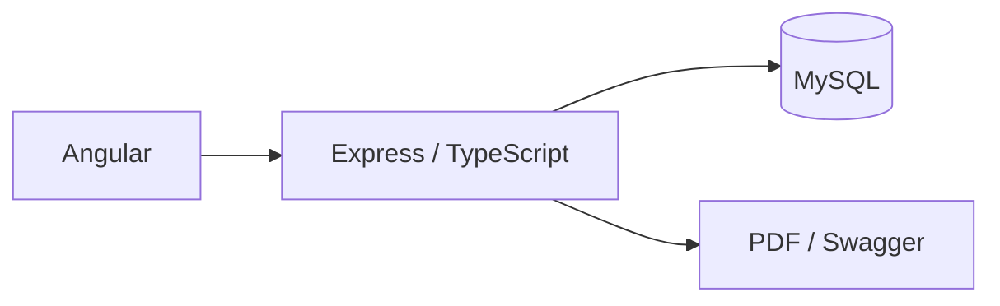

<div align="center">

# Sistema de Vendas | Angular + Node.js

### Gerenciamento de usuários, produtos, estoque e vendas, com API REST em TypeScript e relatórios em PDF.

[](https://github.com/KalleoLeandro/sistema-vendas-angular-node)


       

</div>

---

## ✨ Visão geral

Gerenciamento de usuários, produtos, estoque e vendas, com API REST em TypeScript e relatórios em PDF.

## 🚀 O que você encontra aqui

- **Autenticação e perfis de usuário**
- **CRUD de produtos e usuários**
- **Carrinho, vendas e controle de estoque**
- **Relatórios PDF e documentação Swagger**

## 🧰 Tecnologias

`Angular`, `Node.js`, `Express`, `TypeScript`, `MySQL`, `JWT`, `Jest`, `Swagger`.

## 🖼️ Visão técnica / demonstração



## ▶️ Como explorar / executar

```bash
# Banco: execute o script back-end/sql.txt no MySQL.
cd back-end && npm install && npm run start-dev
# Em outro terminal, na raiz:
cd front-end && npm install && npm start
```
Interface: `localhost:4200`; API: `localhost:3000`; documentação da API: `localhost:3000/api-docs`. Configure o acesso ao banco em `back-end/src/db/conn.ts`.

## 📁 Repositório

```bash
git clone https://github.com/KalleoLeandro/sistema-vendas-angular-node.git
cd sistema-vendas-angular-node
```

[Consultar os arquivos e o histórico do projeto](https://github.com/KalleoLeandro/sistema-vendas-angular-node)

## 📝 Observações

> **Segurança:** substitua as credenciais de demonstração existentes nos scripts/configurações antes de disponibilizar a aplicação.

---

<div align="center">

Desenvolvido e mantido por [Kalleo Leandro](https://github.com/KalleoLeandro).

</div>
